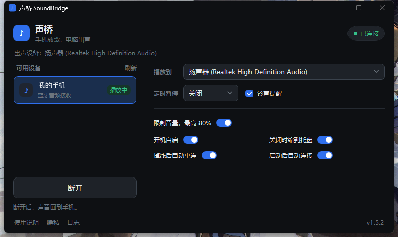

# 声桥 SoundBridge

电脑当蓝牙音箱用：手机的声音，从电脑的耳机或音箱里出来。

Windows 从 10 2004 起就能接收手机的蓝牙音频（专业说法叫 A2DP Sink），但系统只给了底层接口，**没有任何界面去开它、管它**。声桥补的就是这个界面。



---

## 什么时候用得上

这几个场景是它存在的理由，技术细节都在后面。

**一、电脑和手机同时在用，声音只给自己听。**

台式机接着耳机，手机上刷到个视频——外放会吵到一屋子人，不点开又心痒。连上声桥，手机的声音直接进你耳机，电脑这边该放什么放什么，两个人的声音各走各的，谁也听不见谁的。

宿舍、合租房、办公室、图书馆，这是最常被用到的一个。

**二、一边打游戏一边刷手机。**

游戏声音在耳机里，手机视频声音也在耳机里，两条音轨同时在放，不用摘耳机、不用把音量开到最大去盖住外放。想切换就先按「暂停」，耳朵里立刻清静。

**三、手机放桌上充电，用电脑音箱放歌。**

手机插着线不方便挪，电脑音箱音质好得多。连上之后手机就是遥控器：选歌、切歌、调音量都在手机上，声音从音箱出来。

**四、晚上戴耳机听着睡着。**

设个「定时暂停」，到点自动断开，手机上的播放器一般会跟着停。可选「铃声提醒」，断开时短促响一声（不是闹铃那种，吵不醒人）。

**五、开会、上课时偷偷听。**

手机端发来的语音、会议直播，用电脑耳机听，旁边的人听不到。控制音量上限打开后，连接时会自动把声音压到 80% 以内，免得一开播就轰一下。

---

## 它能做什么

- 列出**已配对、支持音频接收**的手机，点一下就连接
- **声音输出可选**：电脑接了耳机 / 音箱 / 显示器音响，自己挑往哪儿放
- **连接时把音量压到 80% 以内**，防止一开播炸耳朵
- **定时暂停**：15 分钟到 2 小时，也可以填任意分钟数；可选「铃声提醒」
- 关闭窗口缩到托盘，托盘菜单里也能连；托盘图标会显示当前状态
- 开机自启、启动即连上次那台手机
- 断线自动重连；**睡眠唤醒后自动把连接重建起来**
- 首次启动先讲清「什么情况下用不了」，之后随时能从左下角重看
- **轻量**：空闲 CPU 0%、私有内存约 65 MB、启动 0.7 秒（实测见文末）

## 它不能做什么

这几条是蓝牙协议和 Windows 本身的限制，不是没做：

- **不能控制手机的播放**。上一首 / 下一首 / 暂停走 AVRCP，Windows 没有公开的控制器接口。想让手机上停下，只能用「定时暂停」这种曲线办法：断开连接，多数 App 会自己停。
- **不是给电脑接蓝牙耳机用的**。那个是 Windows 自带功能。两者可以串起来：手机 → 电脑（声桥）→ 蓝牙耳机，把耳机设成默认输出就行。
- **延迟约 0.2 秒**。听歌无感，看视频会音画不同步。
- **同一时间只能连一台手机**。

---

## 下载

到 [Releases](https://github.com/304713/soundbridge/releases/latest) 下载 `SoundBridge-1.5.2-win-x64.zip`，**解压后双击 `SoundBridge.exe`**。免安装、不需要装 .NET 运行时。

> 要先解压再运行，不能从压缩包里直接双击。这是为了换来更小的内存占用：私有内存 153 MB → 65 MB，启动快 400 毫秒。

首次运行会被 SmartScreen 拦一下（未购买代码签名证书），点「更多信息」→「仍要运行」。

## 三步用起来

1. 在 Windows「蓝牙和其他设备」里把手机和电脑配对
2. 打开声桥，选中手机，点「连接」
3. 手机上放音频

第一次打开会先弹一页说明。核心只有一条：**你的电脑蓝牙要支持「接收」音频**（A2DP Sink）。列表里能看到手机就是支持，一直是空的就基本是不支持。这一页之后可以从主界面左下角「使用说明」重看。

## 常见问题

**列表里一直是空的。**

按这个顺序查，几乎都能解决：

1. **电脑的蓝牙开着吗**——被关掉或被飞行模式关掉时，列表一定是空的。声桥会在列表下面直接写出来是哪种情况。
2. **手机的蓝牙开着吗**——手机开飞行模式、关蓝牙，电脑也看不到它。
3. **配对过吗**——只连过一次不算，要在系统蓝牙设置里完成配对。
4. **适配器支持接收吗**——笔记本内置的 Intel / Realtek 适配器有一部分只开放「发送」：能连蓝牙耳机，不能当音箱。换一个支持 A2DP Sink 的 USB 适配器（几十块）就行，软件绕不过去。

**关过蓝牙，手机就不见了。**

蓝牙关掉再打开，接收端要重新枚举：电脑这边几秒后会自己出现；手机那边在系统蓝牙设置里点一下这台电脑，让它重新连。

**提示「系统拒绝了」。**

手机还连着蓝牙耳机或音箱，或者有别的接收软件（BleAudio、Bluetooth Audio Receiver）占着位置。接收端是独占的，同时只能有一个。

**连上了，但没声音。**

先看「播放到」选对没有（最常见），再看系统音量是不是 0、手机有没有静音。

**看视频口型差半拍。**

蓝牙传输本身有 0.2 秒左右延迟。听歌无感，看视频明显。协议决定的，改不了。

---

## 系统要求

| 项 | 要求 |
|---|---|
| 系统 | Windows 10 2004（内部版本 19041）以上 / Windows 11，64 位 |
| 运行时 | 免安装版不需要；从源码编译需要 .NET 8 SDK |
| **蓝牙适配器** | **必须支持 A2DP Sink（接收音频）** |

最后一条是关键。表现为「已经配对了手机，但列表里什么都没有」。这不是程序的问题。

## 隐私

不联网、不收集数据、无遥测。设置和日志都在本地：

```
%APPDATA%\SoundBridge\settings.json
%APPDATA%\SoundBridge\soundbridge.log
```

日志里会记设备名称和蓝牙地址，但**地址只保留前 4 位**（形如 `0123********`）。贴日志求助时不会顺带暴露手机的完整 MAC。

---

## 实现笔记

写给想改代码的人。三个坑花的时间比其余所有功能加起来还多。

**一、默认输出设备消失后不会回落。**

Windows 有个反直觉的行为：默认输出设备消失后，它不会自动回落到别的设备，而是钉住那个已失效的设备。于是会出现「连上了、界面显示已连接，但一点声音都没有，连 3.5mm 耳机也没声」。

所以有了「播放到」这一项：连接时主动把系统默认设备切到你选的那台。这个接口（`IPolicyConfig`）是未公开的，返回值 0 也不代表真的生效，所以切换后会回头核对一次；真不生效就在界面上给一个「去手动选 →」，直接打开系统声音设置。

**二、睡眠唤醒后，连接对象会变成僵尸。**

合盖再打开，蓝牙链路被系统拆掉了，但那个 `AudioPlaybackConnection` 对象**既不抛异常，也不一定触发 `StateChanged`**——它只是静静地失效。表现是界面还写着「已连接」，声音没了，自动重连也不会启动。

正确做法不是等事件，而是监听 `PowerModeChanged`：

```
Suspend → 记录状态
Resume  → 等 2.5s（适配器重新初始化）
        → Dispose 旧对象（句柄已经作废）
        → 轮询等待设备就绪（最多 90s）
        → 走正常的重连退避流程
```

同一次唤醒还有个连带问题：USB 声卡会重新枚举，音频端点的 GUID 整个换掉，只按 ID 保存的输出设备会失配。所以按 ID 找不到时会再按名字兜一层，找到后把新 ID 记回去。

**三、托盘不用 WinForms 之后。**

1.5.1 之前托盘图标借的是 WinForms 的 `NotifyIcon`。改成直接调 `Shell_NotifyIcon` + 原生弹出菜单。

中间试过 WPF 的 `ContextMenu`，能用，但**每多一个带 `HwndSource` 的窗口就要多吃 17～37 MB 私有内存**（每个窗口自带一整套渲染表面），比省下的还多。最后用的是一个屏幕外的 1×1 原生窗口收消息，开销以 KB 计。

原生菜单有个必须处理的细节：弹出前如果没把自己设成前台窗口，**点菜单外面它不会消失**；而 `SetForegroundWindow` 对不属于前台线程的调用会被系统忽略，得先用 `AttachThreadInput` 借一下前台线程，菜单关掉后再把前台还回去。

### 实测数据

窗口打开、空闲、未连接手机，同一台机器 A/B：

| 指标 | 1.5.0 | 1.5.1 |
|---|---|---|
| 私有内存 | 72.1 MB | 64.9 MB |
| 工作集 | 154 MB | 135 MB |
| 加载模块 | 163 | 155 |
| 压缩包 | 67.7 MB | 60.4 MB |

空闲 10 秒 CPU 占用 0 ms。

## 从源码编译

```bash
dotnet build -c Release
dotnet run -c Release
```

打包成免安装版（文件夹 + zip）：

```bash
dotnet publish -c Release -r win-x64 --self-contained true \
  -p:PublishSingleFile=false -p:PublishReadyToRun=false -o dist

# 自包含发布会把整个 Windows 桌面运行时拷一份，其中 WinForms 那套（约 22 MB）
# 在 1.5.1 之后已经没有任何引用了，运行时不加载，删掉不影响启动
cd dist && rm -f System.Windows.Forms.dll System.Windows.Forms.Primitives.dll \
  System.Windows.Forms.Design.dll System.Windows.Forms.Design.Editors.dll \
  Microsoft.VisualBasic.Forms.dll WindowsFormsIntegration.dll \
  System.Design.dll System.Drawing.Design.dll
```

**不建议再打成「单文件 + 压缩」**。压缩单文件在运行时要把程序集解压进内存才能加载，实测同样的空窗口：压缩单文件私有内存 110 MB，普通文件夹 57 MB；声桥本体则是 153 MB → 65 MB。

`PublishReadyToRun` 也测过：启动再快 60–70 毫秒，包体 +8.6 MB。当前 JIT 只有 4500 个方法、428 KB IL，不是瓶颈，所以没开。

打包成 MSIX（Microsoft Store 格式）见 [`packaging/README.md`](packaging/README.md)。

## 与同类项目

| 项目 | 差异 |
|---|---|
| [AudioPlaybackConnector](https://github.com/ysc3839/AudioPlaybackConnector) | C++/Win32，纯托盘菜单，2020 年后基本停更。本项目的调用顺序（先 `StartAsync` 再 `OpenAsync`）参考了它 |
| [EasyBluetoothAudio](https://github.com/GorangN/EasyBluetoothAudio) | .NET + WPF，功能比本项目更全，活跃维护中 |
| [BluetoothAudioReceiver](https://github.com/Noxy229/BluetoothAudioReceiver) | C#，AMOLED 纯黑界面 |
| [Bleam](https://apps.microsoft.com/detail/9n4g4sh8x95p) | 微软商店版，功能与声桥高度重合，2026 年 8 月上架 |

前面几个都只管建连、把声音交给系统默认设备，**没有输出设备选择，也都没处理睡眠唤醒**。

## 许可证

[MIT](LICENSE)

## 免责声明

**免费、开源、个人业余项目，不是商业产品**：不收费、无内购、无订阅、无广告，也没有付费支持。

本软件按「现状」提供，不附带任何担保。**它能不能用，取决于你的蓝牙适配器是否支持 A2DP Sink**——硬件不支持时，软件装上也用不了。

使用前请至少读一遍 [DISCLAIMER.md](DISCLAIMER.md) 的第 2 条（硬件兼容性）和第 4 条（音量与听力）。继续使用即视为接受全部条款。
